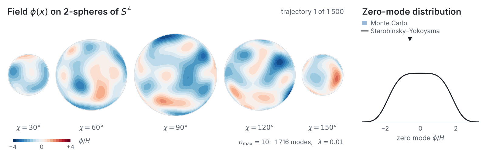

# lattice-dS

<p align="center">
  <a href="https://caravangelo.github.io/lattice-dS/">
    <picture>
      <source media="(prefers-color-scheme: dark)" srcset="animations/banner-dark.gif">
      
    </picture>
  </a>
</p>

lattice-dS is a Python code for lattice Monte Carlo simulations of quantum field theory on Euclidean de Sitter space. It samples the Euclidean path integral on the four-sphere $S^4$, the Euclidean continuation of de Sitter, with the methods of lattice QCD.

This first version focuses on a real scalar field with a $\lambda\phi^4$ interaction; the method and the results are described in [arXiv:XXXX.XXXXX](https://arxiv.org/abs/XXXX.XXXXX). The animation above follows one Monte Carlo chain; click it for an [interactive version](https://caravangelo.github.io/lattice-dS/).

## Method

The field is expanded in real hyperspherical harmonics on $S^4$ and truncated at level $n \le n_{\max}$. Only complete levels are kept, so the retained modes form a representation of the de Sitter isometry group $\mathrm{SO}(5)$. The interaction is computed pseudo-spectrally, by evaluating $\phi^4$ on a real-space grid large enough that the interaction term is computed exactly, without aliasing. The regulated theory is then exactly $\mathrm{SO}(5)$ invariant at finite cutoff.

The mode coefficients are sampled with hybrid Monte Carlo, with Fourier acceleration and randomised trajectory lengths. The constant mode, which carries the infrared physics of a light field in de Sitter space, is additionally redrawn exactly from its conditional distribution after every trajectory.

Everything is plain NumPy and SciPy, and it is efficient enough to run on a laptop (see [Computational cost](#computational-cost)): at $n_{\max} = 10$ a configuration has 1716 modes on 379 701 quadrature points.

## Conventions

The code works in units of the Hubble rate, $H = 1$, throughout: the sphere has unit radius and volume $\Omega = 8\pi^2/3$, the field $\phi$ and the bare mass $m^2$ are in units of $H$ and $H^2$, and the coupling $\lambda$ is dimensionless. The field is $\phi = \sum_{n \le n_{\max}} \sum_I c_{nI} Y_{nI}$ and the action is

$$
S = \frac{1}{2} \sum_{n \le n_{\max}} \sum_I \left(\lambda_n + m^2\right) c_{nI}^2 + \frac{\lambda}{4} \int_{S^4} \phi^4 , \qquad \lambda_n = n(n+3),
$$

where level $n$ contains $d_n = (n+1)(n+2)(2n+3)/6$ modes, with potential $V = m^2\phi^2/2 + \lambda\phi^4/4$ and zero mode $\bar\phi = c_0/\sqrt{\Omega}$. In the code the coupling $\lambda$ is called `lam4`, the bare mass $m^2$ is `m2`, and the array of eigenvalues $\lambda_n$ is `lam`.

## Installation

Python 3.10 or later, NumPy 2 and SciPy.

```bash
git clone https://github.com/caravangelo/lattice-dS.git
cd lattice-dS
python -m venv .venv && source .venv/bin/activate
pip install -e ".[figures,dev]"
pytest                      # two to three minutes
```

## A first run

```python
import math
import lattice_ds as L
from lattice_ds import hmc, perturbation as P

n_max, lam = 4, 0.1
m2 = P.one_loop_bare_mass(n_max, lam)        # renormalised mass zero at one loop
ctx, basis = L.setup(n_max, m2, lam)

r = hmc.run(ctx, basis.shell_index, n_max, eps=0.25, n_steps=6,
            n_therm=1000, n_meas=20000, zero_mode_updates=2, keep_samples=False)

phibar = r["c0"] / math.sqrt(L.VOL_S4)       # the zero mode
print((phibar**2).mean(), "Starobinsky-Yokoyama:", P.SY_PHIBAR2 / math.sqrt(lam))
```

`python examples/quickstart.py` runs this with error bars and compares with the Starobinsky–Yokoyama distribution and its one-loop correction.

## Running chains

Installing the package also installs the `lattice-ds` command, which runs Monte Carlo chains and writes one `.npz` file per chain:

```bash
# independent chains on a grid of points (n_max, lambda, m^2), in parallel
lattice-ds run --n-max 4 6 --lam 0.1 1 --one-loop-mass --seeds 4 --n-meas 20000 --outdir runs/scan

# one chain with the zero mode held fixed: mean force, and the curvature at phibar = 0
lattice-ds run-constrained --tag n4_l1 --n-max 4 --lam 1 --m2 -0.7116 --phibar 0.0 \
    --n-meas 100000 --outdir runs/constrained

# one unconstrained chain that also records the force on the zero mode
lattice-ds run-with-force --tag n4_l1 --n-max 4 --lam 1 --m2 -0.7116 --n-meas 50000 --outdir runs/force
```

`lattice-ds <command> --help` lists the options. An existing chain file is never overwritten. `run` and `run-constrained` checkpoint as they go, resume exactly after an interruption (a restart with different settings is refused), and flag any chain that fails the sampler health check (acceptance, and $\langle e^{-\Delta H}\rangle = 1$). Each file records the seed, step size and number of leapfrog steps; on one machine a chain is exactly reproducible from its seed. The file format is described in [`reproduction/README.md`](reproduction/README.md).

## Computational cost

| $n_{\max}$ | modes | quadrature points | time per trajectory |
|---|---|---|---|
| 4 | 105 | 12 393 | 2 ms |
| 6 | 336 | 54 925 | 6 ms |
| 8 | 825 | 162 129 | 16 ms |
| 10 | 1716 | 379 701 | 37 ms |

Times are for one HMC trajectory at the default settings (step size 0.25, six leapfrog steps, two zero-mode updates), on one core of a MacBook Pro (Apple M3 Max, 2023). A chain of 20 000 trajectories at $n_{\max} = 10$ therefore takes about 12 minutes. `lattice-ds run` runs independent chains in parallel, one per core.

## Layout

```
src/lattice_ds/   the package
    grid.py           product Gauss quadrature on S⁴
    harmonics.py      real hyperspherical harmonics
    transform.py      separable mode <-> grid transform
    action.py         regulated action, gradient, leapfrog, HMC mass matrices
    hmc.py            the sampler
    zeromode.py       exact heat-bath update of the constant mode
    constrained.py    simulations at fixed zero mode: mean force and curvature
    meanforce.py      massless point and effective coupling from the mean force
    perturbation.py   loop sums, one-loop tuning, Starobinsky–Yokoyama reference values
    stats.py          autocorrelation, jackknife, bootstrap
    cli/              the lattice-ds command
reproduction/     data, analysis and figure scripts of arXiv:XXXX.XXXXX
animations/       the animation page (published with GitHub Pages) and the README banner
examples/         quickstart
tests/            pytest suite
```

Each module starts with a description of the method and its conventions.

## Reproducing published results

The folder [`reproduction/`](reproduction/) contains the data tables, the analysis and the figure scripts of

> A. Caravano, *Lattice Monte Carlo of $\lambda\phi^4$ on Euclidean de Sitter*, [arXiv:XXXX.XXXXX](https://arxiv.org/abs/XXXX.XXXXX) (2026).

The Monte Carlo chains are archived on Zenodo: [doi:10.5281/zenodo.23242257](https://doi.org/10.5281/zenodo.23242257) (it might take a few days for the record to be available at this DOI). [`reproduction/README.md`](reproduction/README.md) explains how to reproduce the figures, the tables and the chains.

The tables and figures in `reproduction/` are computed from the final data set and may show minor differences from the first preprint (arXiv v1).

## AI usage statement

This code was developed with the assistance of Claude (Anthropic), using the models Claude Fable 5.1 and Claude Opus 5.5.

## Citing

If you use this code, please cite arXiv:XXXX.XXXXX; if you use published data, also cite the paper they come from. `CITATION.cff` has the reference in machine-readable form.

## Licence

Code: MIT (`LICENSE`). Data in `reproduction/` and on Zenodo: CC-BY-4.0 (`LICENSE-DATA`).
